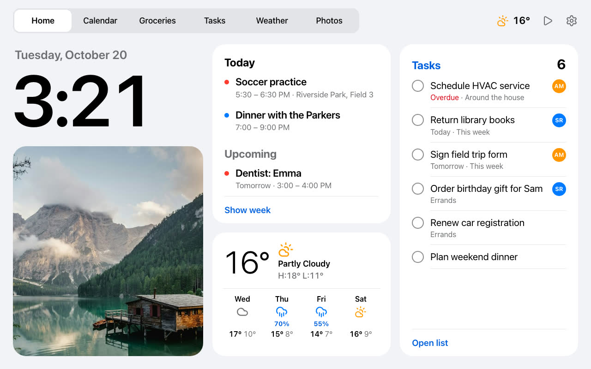

# Photo Frame Dashboard

A glanceable family dashboard for a low-cost Android photo frame. It combines the clock, weather,
family calendars, Todoist lists and an iCloud photo album in one touch-friendly display.



This fork runs on an Anna Bella PF1007L with Android 6.0.1 and WebView 106. The dashboard also
supports similar rooted frames with a 1280×800 display and roughly 1 GB of memory.

## Features

- Home screen with the time, today's events, weather, tasks and a family photo
- Seven-day calendar assembled from Google, iCloud and other iCal feeds
- Interactive Todoist grocery and task lists
- Current conditions, 12-hour forecast and seven-day forecast from Open-Meteo
- Newest-first iCloud Shared Album gallery and full-screen slideshow
- Automatic light and dark themes based on local sunrise and sunset
- Optional Home Assistant music controls and agent messages
- Android kiosk with startup recovery, two-finger controls and floating navigation buttons

Screenshots and demo mode use synthetic data. Personal events, tasks and photos stay outside the
repository.

## How it works

The project has two parts:

- `dashboard/` contains a Svelte 5 application and a Cloudflare Worker. The Worker keeps calendar,
  Todoist and album credentials away from the frame.
- `kiosk/` contains a small Android WebView application that starts the dashboard automatically and
  keeps retrying while Wi-Fi or the device clock recovers after startup.

The target hardware is slow. The interface avoids expensive visual effects, limits background work
and serves photos near their displayed size.

## Requirements

- Node.js 22
- A Cloudflare account with Workers, KV, Durable Objects and Images
- Android Platform Tools for installation on a frame
- JDK 17 and Android SDK build tools 34.0.0 to build the kiosk APK

Root access and WebView replacement are device-specific. Back up a frame before changing its system
partition. See [`docs/frame.md`](docs/frame.md) for the tested PF1007L setup.

## Local development

```sh
git clone https://github.com/JefCurtis/kitchen-frame.git
cd kitchen-frame
cp dashboard/.dev.vars.example dashboard/.dev.vars
cp dashboard/wrangler.example.jsonc dashboard/wrangler.jsonc
cd dashboard
npm ci
npm run dev
```

Add local credentials to `dashboard/.dev.vars`, then open
`http://localhost:5173/?key=<DASHBOARD_KEY>`. The page stores the key in local storage after the
first visit.

Run the tests and production build with:

```sh
npm test
npm run build
```

## Cloudflare deployment

Create a KV namespace and copy its ID into your ignored `dashboard/wrangler.jsonc`:

```sh
cd dashboard
npx wrangler kv namespace create CALENDAR
```

Choose a unique Worker name and configure any project names, weather coordinates and time zone in
that local file. Then deploy and add secrets:

```sh
npm run deploy
npx wrangler secret put CALENDAR_URLS
npx wrangler secret put DASHBOARD_KEY
npx wrangler secret put TODOIST_TOKEN
npx wrangler secret put ALBUM_URL
npx wrangler secret put AGENT_TOKEN
```

`CALENDAR_URLS` accepts Google secret iCal links, iCloud public calendar links and other iCal feeds,
separated by spaces or newlines. `ALBUM_URL` is optional. Weather uses Open-Meteo and needs no API
key.

The real `wrangler.jsonc`, `.dev.vars`, `.prod.vars` and `.frame.vars` files are ignored. Never commit
calendar links, API tokens, album links, dashboard keys, precise coordinates or household names.

## Android kiosk

Build and install the APK:

```sh
./kiosk/build.sh
adb install -r kiosk/build/frame.apk
adb shell am start -n com.huntsyea.frame/.MainActivity \
  -d 'https://your-worker.workers.dev/?key=<DASHBOARD_KEY>'
```

The kiosk remembers the URL. Hold two fingers still for two seconds to reload the dashboard or open
Android settings. The accessibility navigation service adds movable **Back** and **Dashboard**
buttons outside the kiosk.

## Configuration

| Setting | Purpose |
| --- | --- |
| `CALENDAR_URLS` | Space-separated private iCal feed URLs |
| `DASHBOARD_KEY` | Shared key required by the frame API |
| `TODOIST_TOKEN` | Todoist API token |
| `TODOIST_GROCERY_PROJECT` | Grocery project name, default `Groceries` |
| `TODOIST_TODO_PROJECT` | Task project name, default `To-do` |
| `WEATHER_LAT`, `WEATHER_LON` | Weather location |
| `WEATHER_UNIT` | `celsius` or `fahrenheit` |
| `DISPLAY_TZ` | IANA time zone for floating calendar times |
| `ALBUM_URL` | Optional iCloud Shared Album public URL |
| `AGENT_TOKEN` | Optional write-only token for agent messages and recipes |

See [`docs/`](docs/) for feature details and [`CONTRIBUTING.md`](CONTRIBUTING.md) for development
guidance.

## Credits

This project builds on [Hunter Yeagley's Kitchen Frame](https://github.com/huntsyea/kitchen-frame),
which was inspired by [Wes Bos's photo frame dashboard](https://github.com/wesbos/photo-frame-dashboard)
and video about taking over Android photo frames. See [`CREDITS.md`](CREDITS.md) for full attribution.

## License

Released under the [MIT License](LICENSE).
