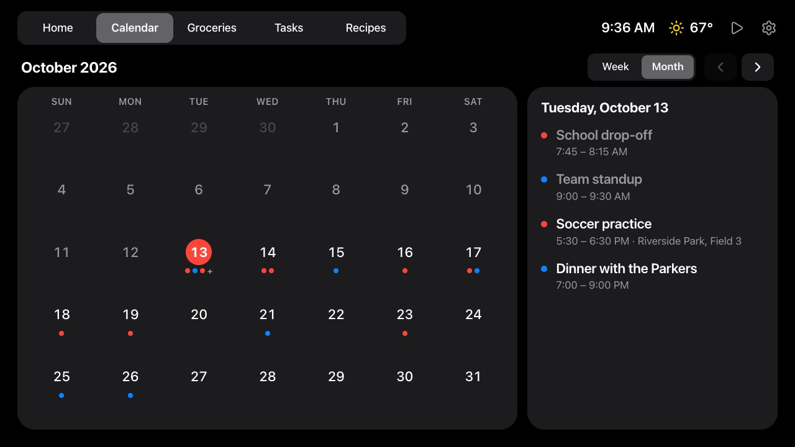
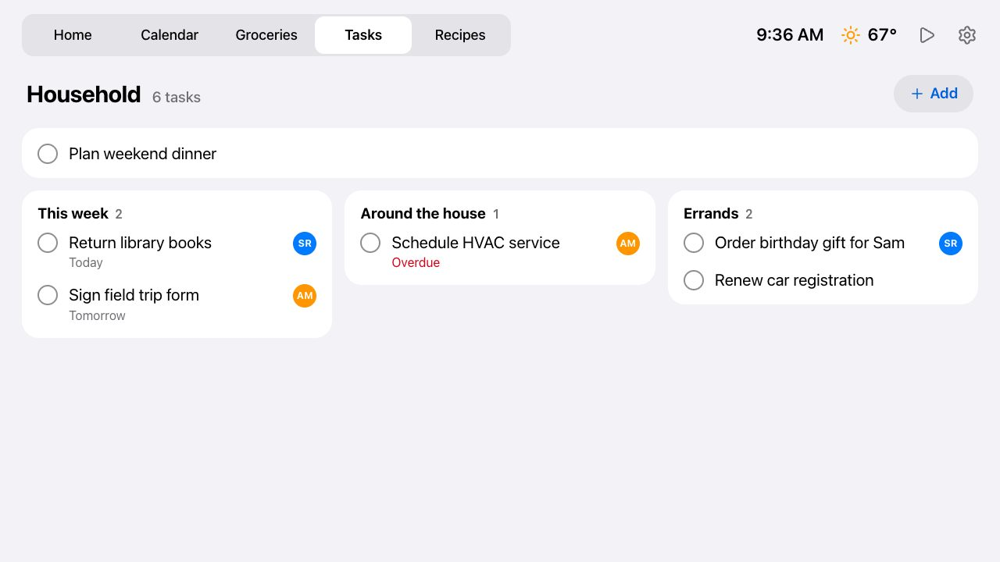
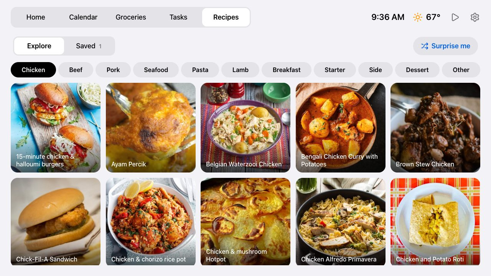

# Photo Frame Dashboard

A calm family dashboard for a cheap Android photo frame on the kitchen wall: clock, weather, the
family calendar, Todoist tasks and groceries, recipes, music controls, messages from AI agents,
and a photo slideshow when nobody's looking. It runs on a ~$50 frame and a Cloudflare Worker.


> **Inspired by Wes Bos.** The idea and the overall approach come from Wes Bos's video
> [Taking over Android photo frames](https://youtu.be/ZLycoUMltNI) and his repository
> [wesbos/photo-frame-dashboard](https://github.com/wesbos/photo-frame-dashboard), which also
> has the device guides for rooting many frame models. This is an independent implementation;
> see [CREDITS.md](CREDITS.md).

| Calendar (dark, after sunset) | Tasks board | Recipes |
| --- | --- | --- |
|  |  |  |

Screenshots use the built-in demo mode, so all data shown is invented.

## Status

Running on a Pastigio FRAME156 (Android 8.1, WebView 106, 1920×1080) in the kitchen. The device
record, every change made to it and how to undo each one are in [docs/frame.md](docs/frame.md).
The developer wiki is in [openwiki/](openwiki/quickstart.md).

## Layout

- `dashboard/src/`: the web app (Svelte 5, no SvelteKit). Tabs: Home (clock, weather, today's
  events, to-dos), Calendar (week and month), Groceries and Tasks (Todoist), Recipes (TheMealDB
  plus saved recipes) and Music (Home Assistant). After 5 minutes untouched
  it switches to an idle clock screen. The frame loads it full screen in a kiosk WebView.
- `dashboard/worker/`: the Cloudflare Worker that serves the app and its API: merged calendar,
  weather (Open-Meteo), Todoist lists, the iCloud shared album (photos proxied and cached in KV),
  recipes (TheMealDB plus saved ones) and agent messages (a Durable Object that pushes them to the
  frame over a WebSocket). Tokens and links for those services stay on the server.
- `docs/research.md`: what we learned from the upstream repo and the video, plus performance constraints.
- `kiosk/`: the Android app the frame boots into (one full-screen WebView). `kiosk/build.sh` builds it
  without Gradle; see `docs/frame.md` for the install and the changes made to our frame.
- `reference/photo-frame-dashboard/`: upstream clone, gitignored. Re-create with
  `git clone https://github.com/wesbos/photo-frame-dashboard reference/photo-frame-dashboard`.

## Run

```sh
cd dashboard
npm install
npm run dev          # http://localhost:5173, also on the LAN for the frame
open "http://localhost:5173/?diag"   # perf overlay (fps, jank, DOM, image megapixels, heap)
```

## Calendar

The Worker merges any number of iCal links into one agenda. A cron job refreshes them into KV
every 10 minutes, writing KV only when something changed (or hourly), and the page polls every 5.
If a feed fails, its last good events stay up.

How often the frame polls each feed (`start()` in `src/lib/state.svelte.js`): calendar every 5
minutes, weather every 15, Tasks every minute while the dashboard is up, Groceries every minute
only while its tab is open, photos every 5 minutes only while the slideshow is showing photos,
and nothing for messages, which are pushed over a WebSocket the moment they're sent
([docs/messages.md](docs/messages.md)). A poll waits for the previous one to finish, and unchanged
results don't redraw the screen. That's roughly 1,500–2,000 Worker requests a day. The account is
on Workers Paid ($5/month), which includes 10 million requests and 1 million KV writes a month, so
this stays inside the included usage with no extra charges.

- **Google:** Settings → your calendar → *Integrate calendar* → **Secret address in iCal format**.
- **Apple (iCloud):** Calendar app → right-click the calendar → *Share Calendar* → **Public
  Calendar** → copy the `webcal://` link (used as-is).

Both links are effectively passwords: anyone with one can read that calendar.

Local dev: `cp dashboard/.dev.vars.example dashboard/.dev.vars`, fill it in, `npm run dev`, then
open `http://localhost:5173/?key=<DASHBOARD_KEY>` once (the page remembers the key).
`npm test` runs the parser tests against the Google and iCloud fixtures in `worker/fixtures/`.

Deploy from `dashboard/`:

```sh
npm run deploy                              # first deploy also creates the CALENDAR KV namespace
npx wrangler secret put CALENDAR_URLS       # both links, separated by a space
npx wrangler secret put DASHBOARD_KEY       # any long random string
curl -H "Authorization: Bearer <key>" "https://photo-frame-dashboard.<you>.workers.dev/api/calendar?refresh"
```

Point the kiosk at `https://photo-frame-dashboard.<you>.workers.dev/?key=<key>`.

Workers Paid (this account's plan) allows 30 s of CPU per cron run; the Free plan allows only
10 ms. Old one-off events are skipped before parsing and long-running repeats are fast-forwarded,
so the calendar would also fit on Free unless it's very large.

## Light and dark

The theme follows the sun: light from sunrise to sunset (from the weather feed), dark otherwise,
with 7 AM / 7 PM as the fallback before weather loads. On the idle clock screen the clock uses the
colour chosen in Settings and dims at night, as do the photos (or they're off at night, per Settings). Pin a
theme with `?theme=light` or `?theme=dark` (remembered on the frame); `?theme=auto` goes back to
following the sun. Both themes are CSS variables, so switching costs one repaint and no memory.

## Weather and Todoist

- **Weather:** set `WEATHER_LAT` and `WEATHER_LON` (plus `WEATHER_UNIT="celsius"` if you want it)
  as secrets (`npx wrangler secret put`, as this deployment does) or `vars` in
  `dashboard/wrangler.jsonc`, and in `.dev.vars` locally. Open-Meteo needs no key.
- **Todoist:** `npx wrangler secret put TODOIST_TOKEN` (Todoist → Settings → Integrations →
  Developer → API token). By default the lists read the projects named **Groceries** and
  **To-do**; `TODOIST_GROCERY_PROJECT` / `TODOIST_TODO_PROJECT` in `wrangler.jsonc` point them
  elsewhere (here: "Grocery List" and "Household"). Tapping an item completes
  it in Todoist, and items can be added from the frame.

## Messages from agents

AI agents can post full-screen messages to the frame: see [docs/messages.md](docs/messages.md).

## Recipes

Explore recipes from TheMealDB, save your own (agents can send them), and add a recipe's missing
ingredients to Groceries: see [docs/recipes.md](docs/recipes.md).

## The frame

The frame boots into our own kiosk app (`kiosk/`, package `com.huntsyea.frame`): build it with
`kiosk/build.sh`, install with `adb install -r kiosk/build/frame.apk`, and set the dashboard URL
once with `adb shell am start -n com.huntsyea.frame/.MainActivity -d '<url with ?key=>'`.
[docs/frame.md](docs/frame.md) covers getting ADB working, every change made to the device with
its undo command, day-to-day operation, and the Home Assistant setup for the Music tab.

To set up a different frame, start from the upstream device guides in
`reference/photo-frame-dashboard/docs/devices.md` (ADB, root, WebView 106, disabling the vendor
app; some vendor apps accept root commands from the vendor's server), set its time zone (event
times render in it), and measure it with `?diag`.

## Contributing

Issues and pull requests are welcome; see [CONTRIBUTING.md](CONTRIBUTING.md). Report security
problems privately as described in [SECURITY.md](SECURITY.md).

## Credits and license

Inspired by [Wes Bos](https://github.com/wesbos/photo-frame-dashboard)
([video](https://youtu.be/ZLycoUMltNI)). Weather data by [Open-Meteo](https://open-meteo.com),
recipes from [TheMealDB](https://www.themealdb.com), icons from [Lucide](https://lucide.dev).
Full credits in [CREDITS.md](CREDITS.md).

Released under the [MIT License](LICENSE).
